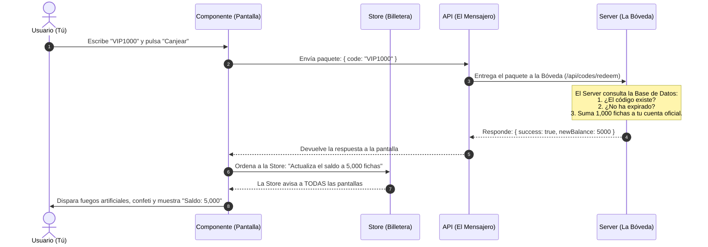

# 🏛️ Guía Visual: ¿Cómo se comunican los Componentes, la Store, la API y el Server?

> **Nota para principiantes:** Si nunca has programado o no entiendes la jerga técnica, ¡no te preocupes! Este documento está diseñado para explicártelo usando una analogía del mundo real: **Un Casino real**.

---

## 🎭 La Analogía del Casino

Imagina que entras a jugar a un Casino de verdad. Para que el casino funcione de forma ordenada y nadie haga trampa, hay 4 piezas fundamentales:

```
[ 1. Mesa y Pantallas ]  ◄──►  [ 2. Tu Billetera ]  ◄──►  [ 3. El Mozo / Ventanilla ]  ◄──►  [ 4. La Bóveda Central ]
    (COMPONENTES)                  (STORE)                     (API)                         (SERVER / BD)
```

1. **Los Componentes (La Mesa de Juego y los Botones):**
   Es todo lo que tus ojos ven y tus manos tocan. El tapete verde de Blackjack, los botones que dicen "Pedir Carta" o "Apostar", y las animaciones de las monedas volando.
2. **La Store (Tu Billetera / Tu Memoria Rápida):**
   Es la riñonera o billetera que llevas encima mientras caminas por el casino. Sabe exactamente cuántas fichas tienes en la mano en este segundo. Si gastas 50 fichas en una mesa, tu billetera cambia al instante sin tener que ir al banco cada segundo.
3. **La API (El Mensajero / La Ventanilla de Intercambio):**
   Es el sistema de mensajes o el camarero que lleva tus pedidos. Si quieres canjear un código o recargar dinero, no puedes entrar a la bóveda del banco tú mismo; le pasas un papelito al mensajero (**petición**) y él vuelve con la respuesta (**respuesta**).
4. **El Server (La Bóveda de Seguridad y el Libro Mayor):**
   Es el director del casino y la caja fuerte protegida en el sótano. Ahí está la lista oficial con cuánto dinero tiene realmente cada persona registrada, evitando que alguien falsifique fichas o dibuje dinero de la nada.

---

## 🔍 Paso a Paso: ¿Quién es quién en tu proyecto?

Tu proyecto de Casino está construido con **Nuxt 3**. Aquí puedes ver exactamente qué archivo cumple cada rol:

| Pieza | Nombre Técnico | ¿Qué hace en la vida real? | Archivo de ejemplo en tu código |
| :--- | :--- | :--- | :--- |
| **Componentes** | *Frontend UI / Vue* | Lo que se dibuja en pantalla (botones, ventanas, textos). | [`RechargeDialog.vue`](file:///c:/Users/Galab_LD/Documents/props/components/common/RechargeDialog.vue)<br>[`BlackjackTable.vue`](file:///c:/Users/Galab_LD/Documents/props/components/blackjack/BlackjackTable.vue) |
| **Store** | *Pinia Store* | La memoria viva en el navegador. Guarda tu saldo y cartas activas. | [`stores/blackjack.ts`](file:///c:/Users/Galab_LD/Documents/props/stores/blackjack.ts) |
| **API** | *Rutas HTTP / Fetch* | Las "puertas" y cartas de solicitud entre el navegador y el servidor. | Las llamadas `$fetch('/api/user/sync-chips')` o `$fetch('/api/codes/redeem')` |
| **Server** | *Backend / Nitro + SQLite* | El cerebro que valida reglas, no permite trampas y guarda en disco duro. | [`server/api/user/sync-chips.post.ts`](file:///c:/Users/Galab_LD/Documents/props/server/api/user/sync-chips.post.ts)<br>[`server/utils/db.ts`](file:///c:/Users/Galab_LD/Documents/props/server/utils/db.ts) |

---

## 🎬 La Historia de una Acción: Canjear un Código de Regalo

Veamos qué ocurre exactamente cuando tú como usuario abres la ventana de recarga y escribes un código (por ejemplo, `VIP1000`) para ganar 1,000 fichas:



### Explicación en lenguaje normal de los 4 pasos:

1. **El Componente (`RechargeDialog.vue`):**
   El usuario hace clic en el botón. El componente no sabe si el código es válido o no. Solo dice: *"Oye API, llévale este código al servidor a ver qué dice"*.

2. **La API (`$fetch('/api/codes/redeem')`):**
   Empaqueta el texto en un sobre digital (llamado petición HTTP POST) y viaja por la red hasta el servidor.

3. **El Server (`server/api/codes/redeem.post.ts`):**
   Es el juez. Revisa la base de datos real:
   - Si el código no existe o ya fue usado, responde con un error: *"Código inválido"*.
   - Si es válido, lo marca como usado, suma las fichas en la cuenta del usuario en la base de datos de forma permanente y responde: *"¡Aprobado! Tu nuevo total es 5,000"*.

4. **La Store (`blackjack.ts`):**
   El componente recibe el *"¡Aprobado!"* del servidor y le dice a la Store: `wallet.setChips(5000)`.
   Como la Store es el **núcleo central**, en cuanto el saldo cambia ahí:
   - La barra superior del juego se actualiza automáticamente.
   - La mesa de Blackjack sabe cuántas fichas tienes para apostar.
   - El diálogo de recarga muestra el nuevo número.
   ¡Todo sin necesidad de recargar la página web!

---

## ❓ Preguntas Frecuentes para entender el "Por Qué"

### 1. ¿Por qué no dejamos que el Componente guarde los datos directamente?
Si tuvieras 5 pantallas distintas (Mesa de Ruleta, Mesa de Blackjack, Perfil, Menú Superior, Tienda) y cada una guardara su propio número de fichas, se volverían locas. Si ganas en Blackjack, la Ruleta no se enteraría.
👉 **Por eso existe la STORE**: es una sola fuente de la verdad para toda la pantalla.

### 2. ¿Por qué no dejamos que la Store guarde directamente en la base de datos?
Porque la Store vive en tu navegador (en tu móvil o en Chrome). Si la Store tuviera permiso para cambiar la base de datos directamente, cualquier persona con un poco de curiosidad podría abrir la consola de su navegador y escribir: `fichas = 999999999`.
👉 **Por eso existe el SERVER**: todo lo importante y de dinero se decide en un lugar seguro donde el usuario común no puede meter mano.

### 3. ¿Qué hace la API entonces?
La API es simplemente **el puente y las reglas de conversación**. Define cómo se saludan el navegador y el servidor (qué preguntas se pueden hacer y cómo vienen empaquetadas las respuestas).

---

## 📋 Resumen en una frase

- **Componente**: Lo que **ves y tocas**.
- **Store**: Lo que la aplicación **recuerda en el momento** para que todo esté sincronizado en pantalla.
- **API**: El **cartero** que lleva las cartas de ida y vuelta.
- **Server**: El **banco central** con llave que decide qué es verdad y guarda las cosas para siempre.
