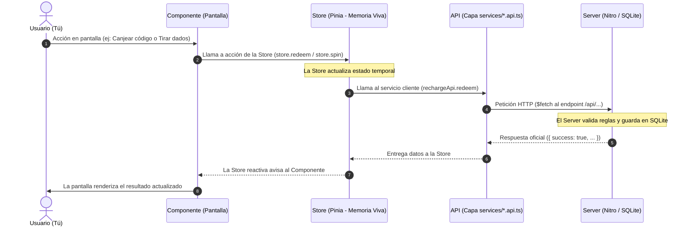

# 🏛️ Guía Visual: ¿Cómo se comunican los Componentes, la Store, la API y el Server?

> **Nota para principiantes:** Si nunca has programado o no entiendes la jerga técnica, ¡no te preocupes! Este documento está diseñado para explicártelo usando una analogía del mundo real: **Un Casino real**.

---

## 🎭 La Analogía del Casino

Imagina que entras a jugar a un Casino de verdad. Para que el casino funcione de forma ordenada y nadie haga trampa, hay 4 piezas fundamentales:

```
[ 1. Mesa y Pantallas ]  ◄──►  [ 2. Tu Billetera ]  ◄──►  [ 3. El Mozo / Ventanilla ]  ◄──►  [ 4. La Bóveda Central ]
    (COMPONENTES)                  (STORE)                     (API)                         (SERVER / BD)
```

1. **Los Componentes (La Mesa de Juego y los Botones):**
   Es todo lo que tus ojos ven y tus manos tocan. El tapete verde de Blackjack, los botones que dicen "Pedir Carta" o "Apostar", y las animaciones de las monedas volando.
2. **La Store (Tu Billetera / Tu Memoria Rápida):**
   Es la riñonera o billetera que llevas encima mientras caminas por el casino. Sabe exactamente cuántas fichas tienes en la mano en este segundo. Si gastas 50 fichas en una mesa, tu billetera cambia al instante sin tener que ir al banco cada segundo.
3. **La API (El Mensajero / La Ventanilla de Intercambio):**
   Es el sistema de mensajes o el camarero que lleva tus pedidos. Si quieres canjear un código o recargar dinero, no puedes entrar a la bóveda del banco tú mismo; le pasas un papelito al mensajero (**petición**) y él vuelve con la respuesta (**respuesta**).
4. **El Server (La Bóveda de Seguridad y el Libro Mayor):**
   Es el director del casino y la caja fuerte protegida en el sótano. Ahí está la lista oficial con cuánto dinero tiene realmente cada persona registrada, evitando que alguien falsifique fichas o dibuje dinero de la nada.

---

## 🔍 Paso a Paso: ¿Quién es quién en tu proyecto?

Tu proyecto de Casino está construido con **Nuxt 3**. Aquí puedes ver exactamente qué archivo cumple cada rol:

| Pieza | Nombre Técnico | ¿Qué hace en la vida real? | Archivo de ejemplo en tu código |
| :--- | :--- | :--- | :--- |
| **Componentes y Páginas** | *Frontend UI / Vue* | Lo que se dibuja en pantalla (botones, ventanas, textos). No hacen peticiones directas. | [`components/common/RechargeDialog.vue`](file:///c:/Users/Galab_LD/Documents/props/components/common/RechargeDialog.vue)<br>[`pages/admin.vue`](file:///c:/Users/Galab_LD/Documents/props/pages/admin.vue)<br>[`pages/apuestas.vue`](file:///c:/Users/Galab_LD/Documents/props/pages/apuestas.vue) |
| **Store** | *Pinia Store* | La memoria temporal en el navegador. Pide al server los datos y los expone a los componentes. | [`stores/wallet.ts`](file:///c:/Users/Galab_LD/Documents/props/stores/wallet.ts)<br>[`stores/recharge.ts`](file:///c:/Users/Galab_LD/Documents/props/stores/recharge.ts)<br>[`stores/preferences.ts`](file:///c:/Users/Galab_LD/Documents/props/stores/preferences.ts)<br>[`stores/apuestas.ts`](file:///c:/Users/Galab_LD/Documents/props/stores/apuestas.ts)<br>[`stores/admin.ts`](file:///c:/Users/Galab_LD/Documents/props/stores/admin.ts)<br>[`stores/blackjack.ts`](file:///c:/Users/Galab_LD/Documents/props/stores/blackjack.ts)<br>[`stores/slots.ts`](file:///c:/Users/Galab_LD/Documents/props/stores/slots.ts)<br>[`stores/ruleta.ts`](file:///c:/Users/Galab_LD/Documents/props/stores/ruleta.ts)<br>[`stores/dados.ts`](file:///c:/Users/Galab_LD/Documents/props/stores/dados.ts)<br>[`stores/poker.ts`](file:///c:/Users/Galab_LD/Documents/props/stores/poker.ts) |
| **API Cliente** | *Capa de Servicios* | Funciones que empaquetan las solicitudes `$fetch` hacia el backend. | [`services/wallet.api.ts`](file:///c:/Users/Galab_LD/Documents/props/services/wallet.api.ts)<br>[`services/recharge.api.ts`](file:///c:/Users/Galab_LD/Documents/props/services/recharge.api.ts)<br>[`services/stats.api.ts`](file:///c:/Users/Galab_LD/Documents/props/services/stats.api.ts)<br>[`services/preferences.api.ts`](file:///c:/Users/Galab_LD/Documents/props/services/preferences.api.ts)<br>[`services/bets.api.ts`](file:///c:/Users/Galab_LD/Documents/props/services/bets.api.ts)<br>[`services/admin.api.ts`](file:///c:/Users/Galab_LD/Documents/props/services/admin.api.ts) |
| **Server y BD** | *Backend / Nitro + SQLite* | Valida reglas, administra sesiones y persiste permanentemente en disco. | [`server/api/stats/[game].*.ts`](file:///c:/Users/Galab_LD/Documents/props/server/api/stats/)<br>[`server/api/user/preferences.*.ts`](file:///c:/Users/Galab_LD/Documents/props/server/api/user/preferences.get.ts)<br>[`server/api/bets/index.*.ts`](file:///c:/Users/Galab_LD/Documents/props/server/api/bets/index.get.ts)<br>[`server/utils/db.ts`](file:///c:/Users/Galab_LD/Documents/props/server/utils/db.ts) |

---

## 🎬 La Historia de una Acción: Flujo Estricto Componente ➜ Store ➜ API ➜ Server



---

## 🏛️ Catálogo Completo de Stores y sus Conexiones con el Servidor

| Store | Propósito | Conexión Servidor | Componentes / Páginas que lo consumen |
| :--- | :--- | :--- | :--- |
| `useWalletStore` | Billetera centralizada única de fichas | `GET /api/auth/me`, `POST /api/user/sync-chips` | Barra superior en `default.vue`, `index.vue`, todas las mesas de juego |
| `useRechargeStore` | Canje de códigos e historial de transacciones | `POST /api/codes/redeem`, `GET /api/user/transactions` | [`RechargeDialog.vue`](file:///c:/Users/Galab_LD/Documents/props/components/common/RechargeDialog.vue) |
| `usePreferencesStore` | Ajustes de usuario (Estilo de baraja Pixel/Classic) | `GET /api/user/preferences`, `PUT /api/user/preferences` | `useDeckStyle.ts`, Blackjack, Baccarat, Poker, Baraja |
| `useApuestasStore` | Mesa de Fichas e historial de apuestas | `GET /api/bets`, `POST /api/bets`, `DELETE /api/bets` | [`pages/apuestas.vue`](file:///c:/Users/Galab_LD/Documents/props/pages/apuestas.vue), [`BetHistory.vue`](file:///c:/Users/Galab_LD/Documents/props/components/common/BetHistory.vue) |
| `useAdminStore` | Panel de control de códigos y estadísticas | `/api/admin/stats`, `/api/admin/codes`, `/api/auth/login` | [`pages/admin.vue`](file:///c:/Users/Galab_LD/Documents/props/pages/admin.vue) |
| `useBlackjackStore` | Mesa de Blackjack 21 | `GET/PUT/DELETE /api/stats/blackjack` + `walletStore` | [`pages/blackjack.vue`](file:///c:/Users/Galab_LD/Documents/props/pages/blackjack.vue) |
| `useSlotsStore` | Tragamonedas (Bronce, Oro, Royal) | `GET/PUT/DELETE /api/stats/slots` + `walletStore` | [`pages/tragamonedas.vue`](file:///c:/Users/Galab_LD/Documents/props/pages/tragamonedas.vue) |
| `useRuletaStore` | Ruleta Europea con reglas oficiales | `GET/PUT/DELETE /api/stats/ruleta` + `walletStore` | [`pages/ruleta.vue`](file:///c:/Users/Galab_LD/Documents/props/pages/ruleta.vue) |
| `useDadosStore` | Craps / Dados con fases y apuestas | `GET/PUT/DELETE /api/stats/dados` + `walletStore` | [`pages/dados.vue`](file:///c:/Users/Galab_LD/Documents/props/pages/dados.vue) |
| `usePokerStore` | Texas Hold'em Heads-Up contra Dealer | `GET/PUT/DELETE /api/stats/poker` + `walletStore` | [`pages/poker.vue`](file:///c:/Users/Galab_LD/Documents/props/pages/poker.vue) |

---

## 📋 Resumen del Flujo Obligatorio

1. **El Servidor (SQLite)** es la **fuente de la verdad**. Todos los datos definitivos (fichas, estadísticas, preferencias, códigos, transacciones) se guardan ahí.
2. **La API (`services/`)** es el puente tipado que hace las peticiones HTTP (`$fetch`).
3. **La Store (Pinia)** pide temporalmente los datos al servidor en su inicio (`load` / `fetch`), mantiene el estado reactivo en memoria rápida para que la interfaz sea fluida, y sincroniza automáticamente las modificaciones de vuelta al servidor con protección y debounce.
4. **El Componente / Página (Vue)** **NUNCA** llama a la API ni guarda datos en su propio estado aislado: siempre consume y le pide los datos a su Store correspondiente.
