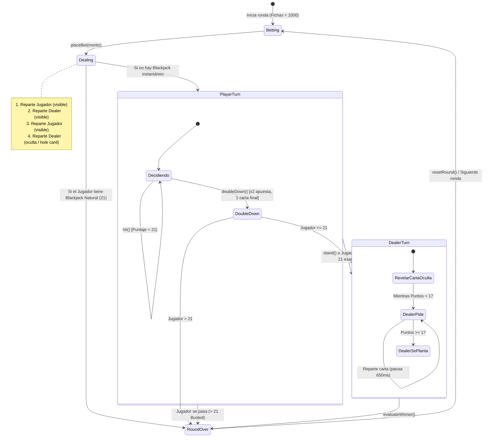

# 🃏 Documento Técnico: Explicación del Código Blackjack Royale

Este documento está diseñado como una **guía completa y estructurada** para entender, defender y explicar cada aspecto del código del juego de Blackjack desarrollado con **Nuxt 3, Vue 3 (Composition API), Pinia y TypeScript**.

---

## 📑 Tabla de Contenidos
1. [Visión General y Stack Tecnológico](#1-visión-general-y-stack-tecnológico)
2. [Arquitectura del Proyecto](#2-arquitectura-del-proyecto)
3. [Tipos de Datos y Modelado (TypeScript)](#3-tipos-de-datos-y-modelado-typescript)
4. [La Máquina de Estados del Juego](#4-la-máquina-de-estados-del-juego)
5. [Lógica del Motor de Juego (`stores/blackjack.ts`)](#5-lógica-del-motor-de-juego-storesblackjackts)
   - [Generación y Barajado Fisher-Yates](#generación-y-barajado-fisher-yates)
   - [Cálculo Dinámico de Puntuación (El valor del As)](#cálculo-dinámico-de-puntuación-el-valor-del-as)
   - [Fase de Reparto Asíncrona](#fase-de-reparto-asíncrona)
   - [Acciones del Jugador: Pedir, Doblar, Plantarse](#acciones-del-jugador-pedir-doblar-plantarse)
   - [Inteligencia del Dealer (Banca)](#inteligencia-del-dealer-banca)
   - [Evaluación de Resultados y Pagos](#evaluación-de-resultados-y-pagos)
6. [La Vista y Orquestación UI (`pages/blackjack.vue`)](#6-la-vista-y-orquestación-ui-pagesblackjackvue)
7. [Comunicación entre Componentes: Props, v-model y Emits](#7-comunicación-entre-componentes-props-v-model-y-emits)
   - [Matriz de Comunicación](#matriz-de-comunicación)
   - [1. Uso de `props` (Flujo Padre ➔ Hijo)](#1-uso-de-props-flujo-padre--hijo)
   - [2. Uso de `v-model` con `defineModel` (Enlace Bidireccional)](#2-uso-de-v-model-con-definemodel-enlace-bidireccional)
   - [3. Uso de `emits` (Flujo Hijo ➔ Padre)](#3-uso-de-emits-flujo-hijo--padre)
8. [Componentes Visuales Especializados](#8-componentes-visuales-especializados)
9. [Efectos Visuales y Sonido Procedural](#9-efectos-visuales-y-sonido-procedural)
10. [Guion de Exposición / Presentación Técnica](#10-guion-de-exposición--presentación-técnica)

---

## 1. Visión General y Stack Tecnológico

El proyecto es una simulación de casino de alta fidelidad (**Blackjack Royale VIP**) que recrea la experiencia de una mesa real de Blackjack (regla de pago 3:2, carta oculta del crupier, animaciones de reparto secuenciales y efectos de sonido sincronizados).

| Tecnología | Rol en el Proyecto |
| :--- | :--- |
| **Nuxt 3 / Vue 3** | Framework principal con Composition API (`<script setup lang="ts">`). |
| **TypeScript** | Tipado estricto para cartas, palos, estados de mano y jugadores. |
| **Pinia** | Store centralizado para la máquina de estados y las reglas de negocio. |
| **Vuetify 3** | Componentes de interfaz (diálogos, botones, iconos MDI, menús). |
| **Web Audio API** | Generación de sonidos de fichas, cartas, victorias y barajado sin dependencias externas pesadas. |
| **Canvas Confetti & CSS3** | Efectos de confeti, sacudida de pantalla (*screen shake*) y giros 3D de naipes. |

---

## 2. Arquitectura del Proyecto

El código sigue el principio de **Separación de Responsabilidades (SoC)**:

```
props/
├── types/
│   └── blackjack.ts         # Contratos e interfaces TypeScript
├── stores/
│   └── blackjack.ts         # Cerebro del juego (lógica pura, estado, finanzas, IA)
├── pages/
│   └── blackjack.vue        # Vista principal (orquestador visual, eventos, diálogos)
├── components/
│   ├── blackjack/
│   │   ├── PlayingCard.vue      # Render de naipe con animación flip y dorsos dinámicos
│   │   ├── BetControls.vue      # Fichas interactivas de apuesta ($10, $25, $50, etc.)
│   │   ├── ActionPanel.vue      # Botones de acción (Pedir, Doblar, Plantarse, Repartir)
│   │   └── GameScoreboard.vue   # Tablero con marcadores, saldo, rachas y win rate
│   └── tragamonedas/
│       ├── SlotReel.vue         # Rodillo individual con animación continua y frenado
│       ├── SlotLever.vue        # Palanca física interactiva 3D con sonido y tiro
│       ├── SlotPaytable.vue     # Tabla dinámica de pagos y combinaciones ganadoras
│       └── SlotMachineSelector.vue # Selector de las 3 máquinas de casino
└── composables/
    ├── useSoundEngine.ts    # Sintetizador y reproductor de audio
    └── useConfetti.ts       # Partículas de victoria y textos flotantes
```

---

## 3. Tipos de Datos y Modelado (TypeScript)

Ubicado en [`types/blackjack.ts`](file:///c:/Users/Galab_LD/Documents/props/types/blackjack.ts):

- **`Card`**:
  ```typescript
  export type Suit = 'hearts' | 'diamonds' | 'clubs' | 'spades'

  export interface Card {
    id: string             // Identificador único (ej: "A_spades_x8f2q")
    suit: Suit             // Palo de la baraja
    value: string          // 'A', '2', ..., '10', 'J', 'Q', 'K'
    numericValue: number   // Valor base (As = 11, Figuras = 10)
    hidden: boolean        // Si está boca abajo (carta tapada del crupier)
  }
  ```
- **`GameStatus`**: Representa las fases del ciclo de juego:
  `'betting'` | `'dealing'` | `'player_turn'` | `'dealer_turn'` | `'round_over'`
- **`PlayerState` & `DealerState`**: Manejan mano de cartas, puntuación calculada, estado (`'playing' | 'stand' | 'busted' | 'blackjack' | 'doubled_down'`), fichas actuales y apuesta en mesa.
- **`GameStats`**: Histórico persistido de victorias del jugador, dealer, empates y partidas totales.

---

## 4. La Máquina de Estados del Juego

El juego opera bajo un flujo lineal y predecible gestionado por la variable reactiva `gameStatus`:



---

## 5. Lógica del Motor de Juego (`stores/blackjack.ts`)

La tienda de Pinia concentra la verdad única (*Single Source of Truth*).

### Generación y Barajado Fisher-Yates
Para garantizar un juego justo y aleatorio idéntico a un casino físico:
- Se generan las 52 cartas multiplicando los 4 palos por los 13 valores.
- Se implementa el algoritmo **Fisher-Yates**:
  ```typescript
  function shuffle(deck: Card[]): Card[] {
    for (let i = deck.length - 1; i > 0; i--) {
      const j = Math.floor(Math.random() * (i + 1));
      [deck[i], deck[j]] = [deck[j], deck[i]]; // Intercambio in situ
    }
    return deck;
  }
  ```

### Cálculo Dinámico de Puntuación (El valor del As)
El As en Blackjack vale **11 o 1**. La función `calculateScore`:
1. Suma primero los valores base (Asume $A = 11$).
2. Si el total supera 21 y existen Ases en la mano, resta $10$ sucesivamente por cada As hasta que el total sea $\le 21$ o ya no queden Ases que reducir.
3. Ignora las cartas marcadas con `hidden: true` para no revelar anticipadamente el puntaje real del crupier en pantalla.

### Fase de Reparto Asíncrona
A diferencia de juegos estáticos donde las cartas aparecen al instante, el método `placeBet`:
- Usa `sleep(ms)` con promesas para simular el ritmo del crupier.
- Dispara eventos de sonido (`card_deal`, `card_slide`) entre cada carta.
- Coloca la segunda carta del crupier con `hidden = true` (la carta en el hoyo o *hole card*).

### Acciones del Jugador: Pedir, Doblar, Plantarse
- **Hit (`hit`)**: Añade una carta. Si supera 21, cambia el estado a `busted`, revela la carta del crupier y termina la ronda. Si llega a 21, hace `stand()` automáticamente.
- **Double Down (`doubleDown`)**:
  - Restricción matemática: Sólo permitido en la primera jugada (cuando se tienen exactamente 2 cartas) y si el jugador tiene saldo suficiente.
  - Duplica la apuesta, recibe una única carta obligatoria y pasa el turno inmediatamente al crupier.
- **Stand (`stand`)**: Bloquea las acciones del jugador y cede el control a la rutina del Dealer.

### Inteligencia del Dealer (Banca)
El crupier no toma decisiones humanas; sigue una estricta regla de casino:
```typescript
while (calculateScore(dealer.value.hand) < 17) {
  emitSound('card_deal');
  dealer.value.hand.push(drawCard());
  await sleep(650); // Ritmo visual realista
}
```
Si el dealer tiene 16, pide carta obligatoriamente; si alcanza 17 o más, se planta.

### Evaluación de Resultados y Pagos
En `evaluateWinner()` se determinan las ganancias:
- **Blackjack Natural**: Paga **3:2** (apuesta devuelta + 150% de ganancia = retorno total de **x2.5**).
- **Victoria estándar o Crupier Busted**: Paga **1:1** (retorno total de **x2**).
- **Empate (*Push*)**: Se reintegra la apuesta original íntegra (**x1**).
- **Derrota o Quiebra (*Bust*)**: Se pierde la apuesta ya descontada.

---

## 6. La Vista y Orquestación UI (`pages/blackjack.vue`)

El archivo de la página es el puente entre el usuario y la tienda:

1. **Desestructuración con `storeToRefs`**:
   Permite extraer propiedades reactivas (`player`, `dealer`, `gameStatus`, `playerScore`, etc.) manteniendo su reactividad intacta.
2. **Sistema de Personalización de Baraja**:
   Permite al usuario elegir entre 4 dorsos de cartas reales (Azul Real, Rojo Rubí, Negro Casino, Verde Mesa).
3. **Observadores (*Watchers*) para Efectos**:
   - Monitorea `lastResult`: si el jugador gana, detona confeti y muestra texto flotante verde con las ganancias. Si pierde, aplica vibración a la pantalla (`screenShake`).
   - Monitorea `currentStreak`: si alcanza una racha $\ge 3$ victorias seguidas, lanza confeti adicional de celebración.
4. **Protección contra Salida Accidental**:
   Si el jugador tiene fichas apostadas en plena ronda e intenta salir al menú principal, se abre un diálogo modal de confirmación (`showExitConfirmDialog`) para evitar la pérdida inadvertida de fichas.
5. **Transiciones CSS (`card-deal`)**:
   Usa `<TransitionGroup name="card-deal">` para que la entrada de cada naipe tenga una animación de desplazamiento y desvanecimiento tridimensional.

---

## 7. Comunicación entre Componentes: Props, v-model y Emits

En Vue 3, la comunicación entre la vista principal (`pages/blackjack.vue`) y sus componentes hijos sigue el patrón estándar **Props Down, Events Up**, complementado con **v-model** para el enlace bidireccional de datos.

### Matriz de Comunicación

| Componente Hijo | `props` (Entrada de datos) | `v-model` (Bidireccional) | `emits` (Salida de eventos) |
| :--- | :--- | :--- | :--- |
| **`BetControls.vue`** | `:max-bet`, `:disabled` | `v-model="betAmount"` | `@place-bet`, `@clear-bet`, `@chip-click` |
| **`ActionPanel.vue`** | `:can-hit`, `:can-stand`, `:can-double-down`, `:is-round-over` | *(No requiere)* | `@hit`, `@stand`, `@double-down`, `@next-round` |
| **`GameScoreboard.vue`** | `:dealer-score`, `:player-score`, `:chips`, `:current-bet`, `:status-message`, `:dealer-wins`, etc. | *(No requiere)* | `@reset-stats` |
| **`PlayingCard.vue`** | `:card`, `:face-down`, `:back-color` | *(No requiere)* | *(No emite eventos directos)* |

---

### 1. Uso de `props` (Flujo Padre ➔ Hijo)

Las **props** permiten que `pages/blackjack.vue` pase información inmutable a los componentes hijos. Se declaran de forma fuertemente tipada con `defineProps<Props>()` y `withDefaults()`.

#### A. En `components/blackjack/BetControls.vue`:
```typescript
interface Props {
  maxBet: number   // Límite máximo de fichas que el jugador puede apostar
  disabled: boolean // Deshabilita los controles si no se está en fase de apuesta
}
const props = defineProps<Props>()
```
*En el padre (`blackjack.vue`)*:
```vue
<BetControls
  v-if="gameStatus === 'betting'"
  :max-bet="player.chips"
  :disabled="gameStatus !== 'betting'"
  ...
/>
```

#### B. En `components/blackjack/ActionPanel.vue`:
```typescript
interface Props {
  canHit: boolean         // Si el botón "Pedir" está activo
  canStand: boolean       // Si el botón "Plantarse" está activo
  canDoubleDown: boolean  // Si el botón "Doblar" está activo
  isRoundOver: boolean    // Alterna entre controles de juego y botón "Siguiente Ronda"
}
defineProps<Props>()
```
*En el padre (`blackjack.vue`)*:
```vue
<ActionPanel
  v-else
  :can-hit="canHit && !isDealing"
  :can-stand="canStand && !isDealing"
  :can-double-down="canDoubleDown && !isDealing"
  :is-round-over="isRoundOver"
  ...
/>
```
> **Nota técnica**: Observa cómo el padre combina variables reactivas (`canHit && !isDealing`). Así, mientras el crupier está animando el reparto de una carta, los botones se bloquean automáticamente sin que `ActionPanel` tenga que conocer el estado interno de la animación.

#### C. En `components/blackjack/PlayingCard.vue`:
```typescript
interface Props {
  card: Card
  faceDown?: boolean
  backColor?: 'navy' | 'red' | 'blue' | 'black' | 'green'
}

const props = withDefaults(defineProps<Props>(), {
  faceDown: false,
  backColor: 'navy',
})
```
*En el padre (`blackjack.vue`)*:
```vue
<PlayingCard
  v-for="card in dealer.hand"
  :key="card.id"
  :card="card"
  :face-down="card.hidden"
  :back-color="cardBackColor"
/>
```
`withDefaults` garantiza que si no se proporciona `faceDown` o `backColor`, el naipe asuma valores seguros por defecto.

#### D. En `components/blackjack/GameScoreboard.vue`:
Recibe todos los datos calculados (`dealerScore`, `playerScore`, `chips`, `currentBet`, `winRate`, `streakText`) para mostrarlos en el encabezado sin acoplarse directamente a la lógica de la partida.

---

### 2. Uso de `v-model` con `defineModel` (Enlace Bidireccional)

`v-model` se utiliza para mantener sincronizado el importe de la apuesta que el usuario va configurando con las fichas.

#### En `components/blackjack/BetControls.vue`:
Utiliza la macro moderna de Vue 3.4+ **`defineModel()`**:
```typescript
// Define el modelo bidireccional con valor inicial 0
const modelValue = defineModel<number>({ default: 0 })

function addChips(amount: number) {
  const next = modelValue.value + amount
  if (next <= props.maxBet) {
    modelValue.value = next // Modifica el valor en el componente...
  } else {
    modelValue.value = props.maxBet
  }
  emit('chip-click')
}

function clearBet() {
  modelValue.value = 0      // Restablece la apuesta a cero
  emit('clear-bet')
}
```

#### En `pages/blackjack.vue`:
```typescript
const betAmount = ref<number>(0)
```
```vue
<BetControls
  v-model="betAmount"
  ...
/>
```

**¿Por qué es importante?**:
Cuando el usuario presiona una ficha de $50 en `BetControls`, `modelValue.value` cambia a `50`. Gracias a `v-model`, `betAmount` en `blackjack.vue` se actualiza de manera reactiva instantánea. Y si desde la página principal se ejecuta `betAmount.value = 0`, el componente hijo refleja el cambio inmediatamente.

Además, en `pages/blackjack.vue` se usa `v-model` con componentes de Vuetify para los modales:
- `v-model="showExitConfirmDialog"`: Controla la visibilidad del diálogo de salir.
- `v-model="showResetStatsDialog"`: Controla la visibilidad del diálogo de reiniciar estadísticas.

---

### 3. Uso de `emits` (Flujo Hijo ➔ Padre)

Los componentes hijos **nunca modifican el store de Pinia directamente**. En su lugar, emiten eventos (`emits`) hacia el padre (`blackjack.vue`), delegándole la toma de decisiones. Esto hace que los componentes sean 100% reutilizables y fáciles de testear.

#### A. En `components/blackjack/BetControls.vue`:
```typescript
const emit = defineEmits<{
  (e: 'place-bet'): void
  (e: 'clear-bet'): void
  (e: 'chip-click'): void
}>()
```
- Al pulsar el botón "Apostar": `emit('place-bet')`.
- Al pulsar "Limpiar": `emit('clear-bet')`.
- Al pulsar una ficha o "All In": `emit('chip-click')`.

*En el padre (`blackjack.vue`)*:
```vue
<BetControls
  @place-bet="handlePlaceBet"
  @clear-bet="handleClearBet"
  @chip-click="handleChipClick"
/>
```
```typescript
function handlePlaceBet() {
  if (betAmount.value > 0) {
    store.placeBet(betAmount.value) // El padre ejecuta la acción en Pinia
    betAmount.value = 0
  }
}
function handleChipClick() {
  sound.playChipClick()           // El padre activa el efecto de sonido
}
```

#### B. En `components/blackjack/ActionPanel.vue`:
```typescript
const emit = defineEmits<{
  (e: 'hit'): void
  (e: 'stand'): void
  (e: 'double-down'): void
  (e: 'next-round'): void
}>()
```
Cada botón ejecuta `emit(...)` al hacer clic:
```vue
<v-btn @click="emit('hit')">Pedir</v-btn>
<v-btn @click="emit('stand')">Plantarse</v-btn>
<v-btn @click="emit('double-down')">Doblar</v-btn>
<v-btn @click="emit('next-round')">Siguiente Ronda</v-btn>
```
*En el padre (`blackjack.vue`)*:
```vue
<ActionPanel
  @hit="handleHit"
  @stand="handleStand"
  @double-down="handleDoubleDown"
  @next-round="handleNextRound"
/>
```
```typescript
function handleHit() { store.hit() }
function handleStand() { store.stand() }
function handleDoubleDown() { store.doubleDown() }
function handleNextRound() { store.resetRound() }
```

#### C. En `components/blackjack/GameScoreboard.vue`:
```typescript
const emit = defineEmits<{
  (e: 'reset-stats'): void
}>()
```
Al pulsar el icono de reinicio en el marcador:
```vue
<v-btn @click="emit('reset-stats')" ... />
```
*En el padre (`blackjack.vue`)*:
```vue
<GameScoreboard @reset-stats="showResetStatsDialog = true" />
```
El padre intercepta el evento y despliega el diálogo modal de confirmación antes de borrar los datos de `localStorage`.

---

## 8. Componentes Visuales Especializados

- **`PlayingCard.vue`**:
  - Representa el naipe físico mediante CSS 3D (`transform-style: preserve-3d`).
  - Cuando `faceDown` es verdadero, la carta rota 180° mostrando la textura del reverso seleccionado.
  - Dibuja el índice numérico, las figuras y los símbolos correspondientes (♠, ♥, ♦, ♣) con sus colores respectivos.
- **`BetControls.vue`**:
  - Fichas interactivas con valores típicos ($10, $25, $50, $100, $500).
  - Incluye botones rápidos para "Duplicar Apuesta", "All-In" y "Limpiar".
- **`ActionPanel.vue`**:
  - Botones ergonómicos para las acciones del juego. Los botones se deshabilitan reactivamente según el estado del turno y si el crupier está repartiendo en ese instante (`isDealing`).
- **`GameScoreboard.vue`**:
  - Muestra el saldo de fichas, la apuesta actual, el porcentaje de efectividad (*win rate*) calculado dinámicamente y la insignia de racha activa (en llamas si gana, hielo si pierde).

---

## 9. Efectos Visuales y Sonido Procedural

- **Audio Procedural con Web Audio API (`useSoundEngine.ts`)**:
  En lugar de depender de pesados archivos MP3 que pueden fallar al cargar, genera ondas de sonido sintetizadas para el chasquido de fichas (*chip click*), el deslizamiento de naipes y fanfarrias de victoria mediante osciladores y filtros.
- **Composables Reactivos (`useConfetti.ts`)**:
  Proporciona utilidades para inyectar elementos visuales efímeros en el DOM:
  - `launchConfetti()`: Partículas multicolores en cascada.
  - `floatingText()`: Indicador que flota hacia arriba indicando el ingreso de fichas (ej. `+200 💰`).
  - `screenShake()`: Desplazamiento oscilatorio rápido de la vista en caso de derrota.

---

## 10. Guion de Exposición / Presentación Técnica

Si tienes que presentar o defender este código frente a un evaluador, profesor o equipo técnico, sigue esta estructura recomendada:

```
1. INTRODUCCIÓN (1 minuto):
   "Buenas. Hoy presento el desarrollo de Blackjack Royale, una aplicación web
    creada en Nuxt 3 y TypeScript que traslada las reglas formales de los casinos a una
    experiencia interactiva con animaciones físicas y gestión de estado reactiva."

2. ARQUITECTURA, ESTADO Y COMPONENTES (2 minutos):
   "Toda la lógica de negocio está aislada en una tienda Pinia mediante una máquina
    de estados finitos: 'betting', 'dealing', 'player_turn', 'dealer_turn' y 'round_over'.
    Para la comunicación entre componentes, aplicamos el estándar Vue 3:
    - Usamos 'props' para transmitir puntuaciones, banderas de acción y estados desde la página.
    - Usamos 'v-model' con la macro moderna 'defineModel' para la sincronización bidireccional
      de la apuesta en BetControls.
    - Usamos 'emits' para que los botones de acción notifiquen intenciones al padre sin
      mutar directamente el estado global, logrando desacoplamiento total."

3. ALGORITMOS CLAVE (2 minutos):
   "Destaco dos algoritmos fundamentales:
    Primero, el barajado Fisher-Yates O(n) para asegurar una probabilidad aleatoria
    sin sesgos.
    Segundo, el algoritmo de puntuación dinámica que evalúa los Ases como 11 o 1 según
    le convenga al jugador para evitar pasarse de 21."

4. DETALLES DE PULIDO Y UX (1 minuto):
   "Para lograr una experiencia inmersiva, los repartos son asíncronos mediante promesas
    temporizadas, el dealer cuenta con IA estricta según las reglas oficiales de la banca,
    y el juego incluye retroalimentación sonora procedural, rachas y persistencia
    local en el navegador."
```

---
*Documento autogenerado para el proyecto Blackjack Royale.*
